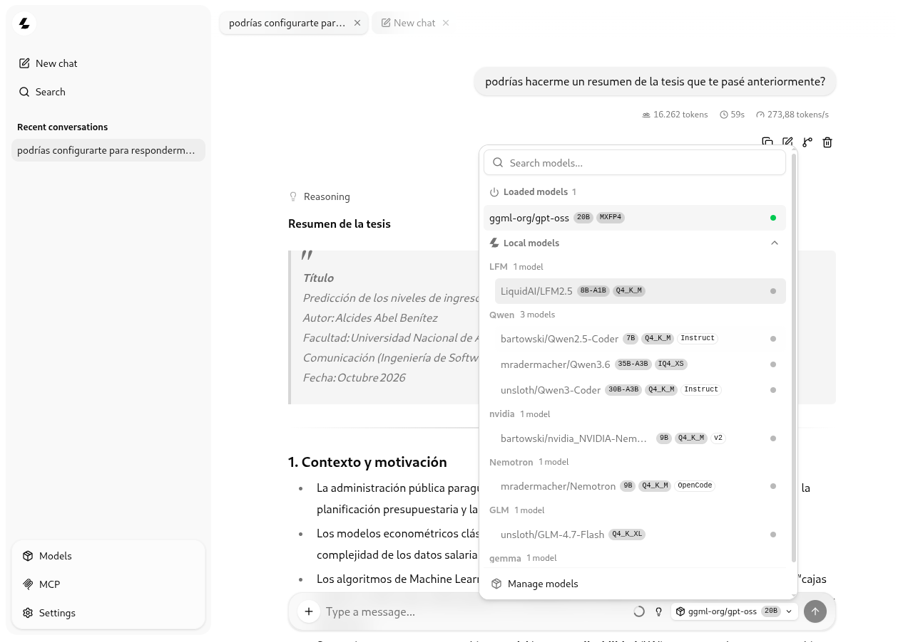

# Modelos de IA locales en la HP de escritorio

Guía de lo instalado, cómo usarlo y qué se puede ajustar en cada archivo.
Última actualización: 12 de noviembre de 2026.

## Resumen

La PC corre modelos de lenguaje en local con **llama.cpp**, usando la gráfica
integrada **Radeon 780M** por Vulkan. Un solo servidor (`modelos.sh`) deja
disponibles nueve modelos, que se eligen con un clic desde el chat en
`http://127.0.0.1:8080`.

Uso diario:

```bash
cd "/home/alcides/Documentos/modelos de IA para HP de Escritorio"
./modelos.sh
```

Después abrir `http://127.0.0.1:8080` y elegir el modelo en el selector que está
junto al cuadro de texto. Para apagarlo, `Ctrl+C` en la terminal.

## El equipo

| Componente | Detalle |
|---|---|
| Equipo | HP Elite SFF 805 G9 |
| Sistema | Debian 13 (trixie), kernel 6.12 |
| CPU | AMD Ryzen 7 8700G (8 núcleos, 16 hilos) |
| GPU usada | Radeon 780M integrada, driver `radv` (Vulkan). En llama.cpp es **`Vulkan1`** |
| GPU no usada | NVIDIA T400 4 GB con driver `nouveau`. En llama.cpp es `Vulkan0` |
| RAM | 32 GB DDR5 (un módulo Samsung en DIMM1, **un solo canal**) |
| Memoria de video | 512 MB fijos del BIOS + **24 GB de GTT** (memoria compartida) |

### Ajuste del kernel (GTT)

Para que la iGPU pueda usar hasta 24 GB de RAM se agregaron dos parámetros en
`/etc/default/grub`, dentro de `GRUB_CMDLINE_LINUX_DEFAULT`:

```
ttm.pages_limit=6291456 ttm.page_pool_size=6291456
```

El valor son páginas de 4 KB: `GB × 1024 × 1024 / 4`. Después de editar:
`sudo update-grub && sudo reboot`.

Para ver el valor actual:

```bash
for c in /sys/class/drm/card*/device; do
  [ -f $c/mem_info_gtt_total ] && echo "$c VRAM: $(( $(cat $c/mem_info_vram_total)/1024/1024 )) MB  GTT: $(( $(cat $c/mem_info_gtt_total)/1024/1024 )) MB"
done
```

Es un límite, no una reserva: la memoria solo se ocupa mientras hay un modelo
cargado.

## llama.cpp

Está compilado con Vulkan en `~/llama.cpp` (versión `2e325dcd5`, build 12297).

Dependencias instaladas:

```bash
sudo apt install -y build-essential cmake git libvulkan-dev glslc \
  libcurl4-openssl-dev vulkan-tools spirv-headers glslang-tools
```

Para actualizarlo y recompilar:

```bash
cd ~/llama.cpp
git pull
cmake -B build -DGGML_VULKAN=ON -DCMAKE_BUILD_TYPE=Release
cmake --build build -j 16
```

Después de actualizar conviene repetir algún benchmark: los resultados de la
tabla de más abajo corresponden a la versión indicada.

## Archivos de esta carpeta

| Archivo | Para qué sirve |
|---|---|
| `modelos.sh` | Levanta el servidor con todos los modelos disponibles (Linux) |
| `modelos.ini` | Ajustes comunes y por modelo que usa el servidor |
| `descargar-modelos.sh` | Descarga todos los modelos de una lista (Linux) |
| `modelos.bat` | Igual que `modelos.sh`, para Windows |
| `descargar-modelos.bat` | Igual que `descargar-modelos.sh`, para Windows |
| `qwen.sh`, `gptoss.sh` | Scripts anteriores que levantan un solo modelo. Quedaron reemplazados por `modelos.sh` |
| `benchmarks/benchmarks.json` | Resultados de `llama-bench` de todos los modelos medidos |
| `index.html` | Página con la tabla y los gráficos de los benchmarks (GitHub Pages) |
| `docs/selector-de-modelos.png` | Captura de la interfaz de chat con el selector de modelos |
| `README.md` | Este documento |

Los modelos no están en esta carpeta. Se guardan en la caché de Hugging Face:
`~/.cache/huggingface/hub/` (en Windows, `%USERPROFILE%\.cache\huggingface\hub`).

### `modelos.sh`

Arranca `llama-server` en **modo router**: no carga ningún modelo al inicio y
carga el que se elija desde el chat, de a uno por vez.

```bash
./modelos.sh          # también funciona con: sh modelos.sh
```

- Busca `modelos.ini` en la misma carpeta donde está el script.
- Busca llama.cpp en `~/llama.cpp`.
- Si ya hay un servidor en el puerto, lo detiene antes de arrancar.

Qué se puede ajustar, sin editar el archivo:

| Variable | Valor por defecto | Ejemplo |
|---|---|---|
| `LLAMA_DIR` | `~/llama.cpp` | `LLAMA_DIR=/opt/llama.cpp ./modelos.sh` |
| `PRESET` | `modelos.ini` junto al script | `PRESET=~/otro.ini ./modelos.sh` |
| `PORT` | `8080` | `PORT=8081 ./modelos.sh` |

Dentro del archivo:

- `--models-max 1`: cantidad de modelos cargados a la vez. Con 32 GB de RAM
  tiene que quedar en 1. Con 64 GB se podría subir a 2 para combinar uno grande
  con uno liviano.
- `--host 127.0.0.1`: solo acepta conexiones desde esta PC. Para compartirlo en
  la red se cambia a `0.0.0.0`, pero el servidor no tiene clave: hacerlo solo
  en una red de confianza y, en ese caso, agregar `--api-key`.

**Importante:** el contexto, la GPU y las capas no se pasan por línea de
comandos, porque eso pisa lo que dice `modelos.ini`.

### `modelos.ini`

Define cómo se lanza cada modelo. Cada clave es una opción de `llama-server`
sin los guiones iniciales.

La sección `[*]` vale para todos:

| Clave | Valor | Qué hace |
|---|---|---|
| `device` | `Vulkan1` | Usa la Radeon 780M. Ver nombres con `llama-server --list-devices` |
| `n-gpu-layers` | `99` | Manda todas las capas a la GPU |
| `flash-attn` | `on` | Mejora la lectura del prompt (~15 % en las pruebas) |
| `parallel` | `1` | Un solo usuario; todo el contexto queda para una conversación |
| `jinja` | `true` | Usa la plantilla de chat de cada modelo. Obligatorio para gpt-oss |
| `ctx-size` | `16384` | Contexto por defecto |

Cada sección `[usuario/repo:CUANTIZACIÓN]` ajusta un modelo. El nombre tiene que
coincidir exactamente con el que muestra el servidor al arrancar.

| Modelo | Contexto | Ajuste propio |
|---|---|---|
| gpt-oss-20b | 32k | `chat-template-kwargs = {"reasoning_effort":"medium"}` |
| Qwen3.6-35B-A3B | 32k | |
| Gemma 4 26B A4B | 32k | |
| LFM2.5-8B-A1B | 32k | |
| Nemotron Nano 9B v2 | 32k | |
| Qwen3-Coder-30B-A3B | 16k | |
| GLM-4.7-Flash | 16k | `temp`, `top-p`, `min-p`, `repeat-penalty` recomendados por Z.ai |
| Qwen2.5-Coder 7B | 16k | |
| Nemotron-9B-OpenCode | 16k | |

Ajustes habituales:

- **Contexto (`ctx-size`)**: más contexto permite conversaciones y documentos
  más largos, pero usa más memoria y todo va más lento. Se dejó en 32k para los
  modelos que casi no se frenan con el contexto largo y en 16k para los que
  caen fuerte.
- **Razonamiento de gpt-oss**: cambiar `medium` por `low` (respuestas más
  rápidas) o `high` (más análisis).
- **Agregar un modelo ya descargado**: copiar una sección y cambiar el nombre.
- **Agregar un modelo que se baje al elegirlo**: declarar el repo en la sección.

  ```ini
  [gemma-e4b]
  hf-repo = unsloth/gemma-4-e4b-it-GGUF:Q4_K_M
  ctx-size = 16384
  ```

- **Quitar un modelo**: borrar su sección y, si se quiere liberar disco, su
  carpeta en la caché.

Después de cualquier cambio hay que volver a correr `./modelos.sh`. Para
comprobar que se aplicó, mirar en la terminal los argumentos que imprime al
cargar el modelo (por ejemplo `--ctx-size 32768`).

No se puede fijar un mensaje de sistema desde este archivo: esta versión de
`llama-server` no tiene esa opción. Se configura en la interfaz (ver más abajo).

### `descargar-modelos.sh`

Descarga a la caché todos los modelos de su lista, uno tras otro, con barra de
progreso. Saltea los que ya están y retoma descargas incompletas.

```bash
./descargar-modelos.sh                                    # toda la lista
./descargar-modelos.sh unsloth/gemma-4-e4b-it-GGUF:Q4_K_M # solo ese
```

- Ejecutarlo con `./` o con `bash`, **no con `sh`**.
- La lista está al principio del archivo, en `MODELOS=( ... )`, una línea por
  modelo con el formato `usuario/repo:CUANTIZACIÓN`. Una línea que empieza con
  `#` se ignora.
- Para descargar usa `llama-bench` con una prueba mínima, así que muestra una
  tabla de una línea por modelo. No es una medición.
- La lista completa ocupa unos 110 GB.
- Esta lista y `modelos.ini` son independientes: un modelo nuevo hay que
  agregarlo en los dos si se quieren ajustes propios.

### `modelos.bat` y `descargar-modelos.bat` (Windows)

Equivalentes a los dos scripts anteriores. Se ejecutan con doble clic o desde
una terminal, y tienen que estar en la misma carpeta que `modelos.ini`.

Buscan llama.cpp en este orden: la variable `LLAMA_DIR`, una carpeta `llama.cpp`
junto al archivo, y el PATH del sistema.

Antes de usarlos en otra PC:

- Cambiar o borrar `device = Vulkan1` en `modelos.ini`; ese nombre es de esta HP.
- Revisar los contextos y elegir modelos según la memoria de esa máquina.
- Los modelos hay que descargarlos de nuevo.

Estos dos archivos no se probaron en Windows.

## La interfaz de chat

`http://127.0.0.1:8080`, con `modelos.sh` corriendo.



*El selector de modelos abierto: arriba el modelo cargado (punto verde) y debajo
los demás modelos locales, listos para cargarse con un clic.*

- **Cambiar de modelo**: selector junto al cuadro de texto. La primera respuesta
  tarda 10–30 segundos porque tiene que cargarlo.
- **Responder siempre en español**: configuración (engranaje) → *System
  Message*. Queda guardado en el navegador y vale para todos los modelos. Hay
  que repetirlo si se entra desde otro navegador.
- **Idioma de la interfaz**: solo inglés. Se puede usar la traducción del
  navegador, o instalar Open WebUI, que sí viene en español y se conecta a
  `http://127.0.0.1:8080/v1` (pendiente, no se instaló).
- **Conversaciones largas**: al acercarse al límite de contexto conviene abrir
  un chat nuevo y pegar un resumen. Un chat de más de 20.000 tokens tarda
  alrededor de un minuto en procesarse la primera vez y genera más lento.

Otros programas (Continue en VS Code, AnythingLLM, Aider) se conectan a la misma
dirección `http://127.0.0.1:8080/v1`; el nombre de modelo que se configure en
ellos decide cuál se carga.

## Modelos y resultados

Medidos con `llama-bench` en esta PC: tokens por segundo con el contexto ya
ocupado por 0, 4.096 o 16.384 tokens.

- **Generación**: velocidad al escribir la respuesta. Es lo que se siente al chatear.
- **Lectura**: velocidad al procesar lo que se le envía. Pesa con documentos y archivos.

| Modelo | Tamaño | Generación 0 / 4k / 16k | Lectura 0 / 4k / 16k |
|---|---|---|---|
| LFM2.5-8B-A1B | 4,8 GiB | 29,1 / 27,9 / 22,8 | 739 / 703 / 589 |
| Qwen3-Coder-30B-A3B | 17,3 GiB | 16,1 / 12,2 / 7,3 | 283 / 216 / 115 |
| Qwen3.6-35B-A3B | 17,6 GiB | 13,2 / 12,5 / 11,1 | 235 / 215 / 159 |
| gpt-oss-20b | 11,3 GiB | 12,8 / 12,3 / 11,2 | 353 / 327 / 244 |
| GLM-4.7-Flash | 16,3 GiB | 12,4 / 11,0 / 4,2 | 228 / 142 / 54 |
| Gemma 4 26B A4B | 15,8 GiB | 9,1 / 8,2 / 7,8 | 262 / 230 / 161 |
| Qwen2.5-Coder 7B | 4,4 GiB | 7,9 / 7,4 / 5,9 | 264 / 221 / 152 |
| Nemotron Nano 9B v2 | 6,1 GiB | 5,3 / 5,2 / 5,1 | 174 / 168 / 155 |
| Nemotron-9B-OpenCode | 5,7 GB aprox. | sin medir | sin medir |

gpt-oss-20b se midió dos veces y figura el promedio.

También se midió **Nemotron 3.5 Lightning 30B A3B** (10,5 / 10,4 / 10,1 de
generación), el que menos se frena con el contexto. Se eliminó porque su archivo
de 23,5 GiB casi llena los 24 GB de GTT. Vale la pena retomarlo con 64 GB de RAM
o en una cuantización más chica.

Los datos completos, con desvío estándar y fecha de cada medición, están en
`benchmarks/benchmarks.json`.

Los gráficos interactivos están en
<https://aabenitez.github.io/llm-local-hp-805-g9/>. La página lee ese mismo
archivo, así que se actualiza sola al agregar mediciones.

### Qué se aprendió

- En esta PC la velocidad depende de los **parámetros activos por token**, no
  del tamaño del archivo. Por eso los modelos MoE (que activan solo una parte)
  le ganan a los densos chicos: Qwen3-Coder-30B genera al doble que
  Qwen2.5-Coder 7B pesando cuatro veces más.
- El **contexto largo** frena mucho a algunos (Qwen3-Coder, GLM) y casi nada a
  otros (gpt-oss, Qwen3.6, Nemotron).
- Estos números miden velocidad, **no calidad** de las respuestas.

### Cuál usar

| Tarea | Modelo sugerido |
|---|---|
| Código (chat, refactors) | Qwen3-Coder-30B-A3B |
| Documentos largos, RAG, análisis | gpt-oss-20b o Qwen3.6-35B-A3B |
| Tareas rápidas y simples: resumir, extraer datos, consultas cortas | LFM2.5-8B-A1B |
| Imágenes, capturas, documentos escaneados | Gemma 4 26B A4B o Qwen3.6-35B-A3B |

## Medir un modelo nuevo

```bash
cd ~/llama.cpp
mkdir -p ~/benchmarks
./build/bin/llama-bench -hf USUARIO/REPO:CUANTIZACION \
  -dev Vulkan1 -ngl 99 -fa on -p 512 -n 128 -d 0,4096,16384 \
  --progress -o json > ~/benchmarks/NOMBRE.json
```

- Si el modelo no está descargado, primero lo baja **sin mostrar la barra**
  (parece colgado). Se puede seguir el avance con
  `watch -n 10 du -sh ~/.cache/huggingface/hub/models--*`.
- Conviene cerrar el servidor antes de medir, para que no compitan por memoria.
- Usar siempre los mismos parámetros para que los resultados sean comparables.

## Mantenimiento

Ver cuánto ocupa cada modelo:

```bash
du -sh ~/.cache/huggingface/hub/models--* | sort -h
```

Borrar un modelo (y después quitar su sección de `modelos.ini`):

```bash
rm -rf ~/.cache/huggingface/hub/models--USUARIO--REPO
```

Buscar descargas que quedaron a medias:

```bash
find ~/.cache/huggingface -name "*.incomplete" -exec ls -lh {} \;
```

Ver los modelos que reconoce el servidor y su estado:

```bash
curl -s http://127.0.0.1:8080/v1/models | python3 -m json.tool | grep -E '"id"|"value"'
```

## Problemas frecuentes

| Síntoma | Causa y solución |
|---|---|
| `llama-server: not found` | El script no encuentra llama.cpp. Indicar la ruta con `LLAMA_DIR=...` |
| “Server unavailable” en el chat | El servidor no está corriendo. Ejecutar `./modelos.sh` |
| `request (N tokens) exceeds the available context size` | La conversación superó el contexto. Subir `ctx-size` de ese modelo o abrir un chat nuevo |
| Un comando parece colgado al medir o descargar | Está bajando el modelo sin barra de progreso. Revisar el tamaño de la caché |
| `invalid parameter` en `llama-bench` con `-m $MODELO` | La variable estaba vacía. Usar `-hf usuario/repo:cuant` |
| Error de memoria o la PC se pone muy lenta | El modelo más su contexto no entran. Cerrar programas, bajar `ctx-size` o usar una cuantización menor |
| Error de arquitectura con un modelo nuevo | Actualizar y recompilar llama.cpp |
| La GPU elegida es la NVIDIA | Falta `device = Vulkan1`. Ver nombres con `llama-server --list-devices` |

## Pendientes y mejoras

**Segunda memoria RAM (la mejora más importante).** Hoy la RAM trabaja en un
solo canal, y eso limita la velocidad de generación de todos los modelos.

- Módulo a comprar: 32 GB DDR5-5600 UDIMM, idealmente igual al instalado
  (Samsung `M323R4GA3EB0-CWM`). El equipo admite hasta 128 GB en 4 ranuras.
- Va en la ranura **DIMM3** (canal A), para que cada canal tenga un módulo.
- Después de instalarlo, subir el GTT a 48 GB cambiando los dos valores de GRUB
  a `12582912`, y repetir los benchmarks.

**Otras ideas:**

- Probar la calidad de las respuestas con tareas reales propias, no solo la velocidad.
- Medir Nemotron-9B-OpenCode y Gemma 4 E4B.
- Instalar Open WebUI para tener la interfaz en español, historial y carga de documentos.
- Agregar un modelo de embeddings (bge-m3) para consultar documentos (RAG).
- Conectar Continue en VS Code al servidor local.
